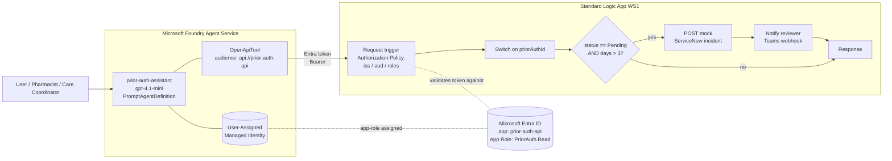
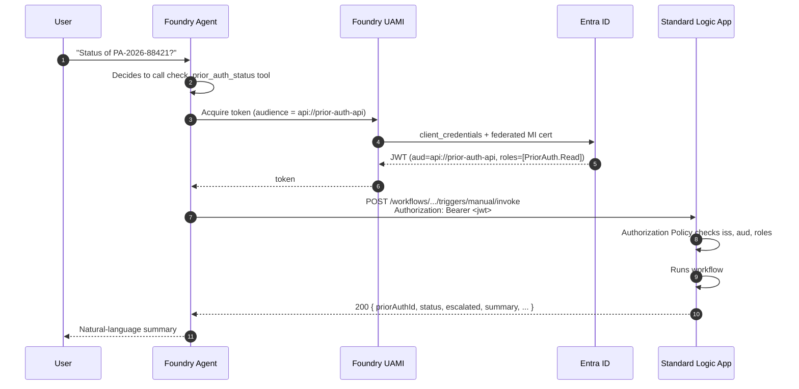

# Architecture

## Component diagram

## Token flow

## Why each piece exists

| Piece | Role | Why not simpler? |
|---|---|---|
| **Standard Logic App (WS1)** | Hosts the workflow. | Consumption doesn't support per-trigger AAD Authorization Policies as cleanly, and can't run inside a VNet. Standard is the production path. |
| **User-assigned Managed Identity** on the Foundry project | Provides the caller identity. | System-assigned would work but rebuilds the SP if the project is recreated, breaking role assignments. UAMI survives. |
| **Entra app registration `prior-auth-api`** | Represents the Logic App's API surface. Owns the audience (App ID URI) and the App Role `PriorAuth.Read`. | You could reuse `https://management.azure.com/` as the audience, but that gives the token broader implicit meaning. A dedicated app registration is the least-privilege pattern. |
| **App Role `PriorAuth.Read`** assigned to the Foundry UAMI | Populates the `roles` claim on the token. | Without a role assignment, the token would have no `roles` claim and the Authorization Policy would reject it. |
| **Trigger-level Authorization Policy** (not App Service Easy Auth) | Per-workflow claim checks, closer to Logic Apps idioms. | Easy Auth is site-wide — heavier hammer if the Logic App eventually hosts multiple workflows with different callers. |
| **OpenAPI tool** on the Foundry agent | Contract that lets the model know when and how to call the workflow. | Foundry classic's "Logic Apps action" wizard is deprecated; OpenAPI is the current GA path. |

## Data flow within the workflow

1. **Request trigger** receives `{ priorAuthId, memberId?, requestingProvider? }`.
2. **Compose `paDataset`** — synthetic in-workflow JSON array (5 sample PAs).
3. **Filter Array** — find matching record for `priorAuthId`.
4. **Condition — Found?**
    - **False**: Response 404 with `{ error: "PA not found" }`.
    - **True**: continue.
5. **Compose `daysOutstanding`** — `div(sub(ticks(utcNow()), ticks(pa.submittedDate)), 864000000000)`.
6. **Condition — Should escalate?** (`status == 'Pending' && daysOutstanding > 3`)
    - **True**:
        1. **HTTP** POST to mock ServiceNow endpoint (`https://httpbin.org/post` in demo).
        2. **HTTP** POST to Teams incoming webhook (URL provided at deploy time).
        3. **Set variable `escalationTicket`** from mock response.
    - **False**: `escalationTicket = null`.
7. **Response** — 200 with the composed summary payload.

The scripted mocks (steps 6.i-6.ii) are deliberately trivial. Replacing them with real ServiceNow + Teams instances is a `docs/healthcare-scenario.md` production step.
